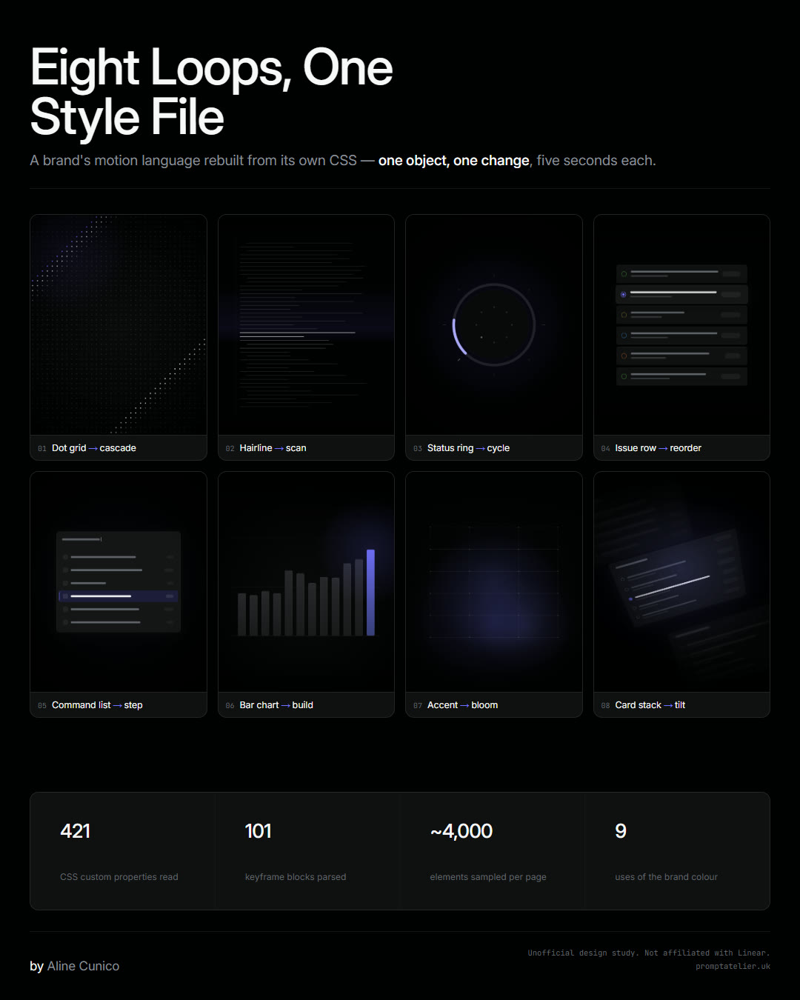

# Publishing Episode 18 to promptatelier.uk

Everything here is built to drop into the `adcunico/prompt-atelier` repo as-is. Nothing has been pushed — these are files for you to copy in and commit.

---

## 1. Copy the files in

From `brand-motion-study/site/` into the root of the `prompt-atelier` repo:

| From | To |
|---|---|
| `site/case-study-ep18.html` | `case-study-ep18.html` |
| `site/ep18/cover-animated.mp4` | `ep18/cover-animated.mp4` |
| `site/ep18/hero.jpg` | `ep18/hero.jpg` |
| `site/ep18/poster.jpg` | `ep18/poster.jpg` |

The page uses your existing `assets/responsive.css`, your nav and your footer — all three were spliced out of `case-study-ep17.html` verbatim, so the markup, links and social SVGs are byte-identical to the rest of the site.

**Optional extras** if you want the page richer later — the eight GIFs in `export/gif/` and the eight stills in `export/stills/` would drop into `ep18/` and give you a contact-sheet section like Ep.17's.

---

## 2. Add the card to the index

In `index.html`, inside `<div class="cases">` in the `#cases` section, paste this as the **first** card so it leads the rail:

```html
<a class="case" href="case-study-ep18.html">
  <div class="thumb"></div>
  <div class="body">
    <div class="ep">Episode 18 &middot; Claude Code + Brand Motion</div>
    <h3>EIGHT LOOPS FROM A STYLE FILE: a brand's motion, read from its CSS</h3>
    <p>I stopped describing brands in adjectives and started handing Claude their stylesheets. 421 measured values, one style file, eight seamless loops &mdash; and a reusable extractor you can point at any brand's site.</p>
    <div class="read">Read the case study &rarr;</div>
  </div>
</a>
```

---

## 3. Commit

```bash
git add case-study-ep18.html ep18/ index.html && git commit -m "Ep.18 — Eight loops from a style file"
```

Then push. GitHub Pages serves from the repo, so it goes live on the next build.

---

## Before you publish — two things to decide

**The repo link.** The page's GitHub button currently points at `https://github.com/adcunico/brand-motion-study`, which **does not exist yet**. Either create that repo from the `brand-motion-study/` folder, or tell me the name you want and I'll rebuild the page with it:

```bash
node site/build-page.mjs site/_ref-ep17.html
```

(The URL is the `REPO` constant at the top of `build-page.mjs`.)

**Whether to name the brand.** The page currently says "a design-led product site" and "the brand studied" throughout, and the disclaimer says "not affiliated with the brand studied". Naming Linear explicitly is the more honest and more interesting version — and it's what the LinkedIn post's first comment does. Your call; it's a two-word find-and-replace either way.

---

## Housekeeping

`site/_ref-ep17.html` is a local copy of your Ep.17 page, used only as the source for the nav and footer. Delete it before committing — it does not belong in either repo.
